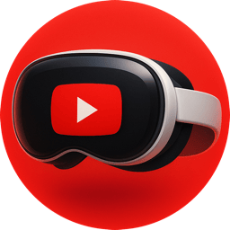
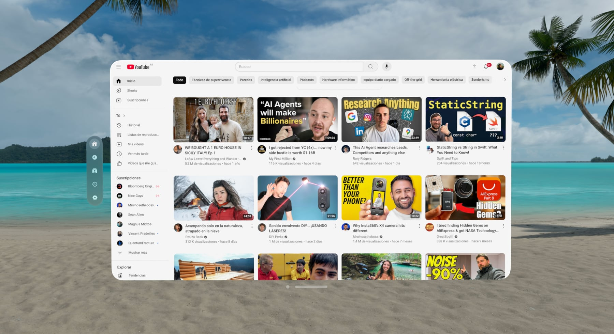

<p align="center">
  
</p>

<h1 align="center">Yutub</h1>

<p align="center">
  <strong>YouTube as a real app on Apple Vision Pro.</strong><br />
  A native visionOS window around YouTube, with controls made for eyes and hands.
</p>

<p align="center">
  
  
  
  
  <a href="LICENSE"></a>
</p>



Vision Pro has no YouTube app, and YouTube in Safari is made for a mouse: small buttons and a tiny progress bar to aim at with your eyes. Yutub is a small SwiftUI app that wraps YouTube in its own window and reshapes the player so it's comfortable to use with a look and a pinch.

## Features

- **Big, centred playback controls.** Previous, play/pause and next float in the middle of the video, so you don't have to aim at the bottom bar.
- **A progress-bar thumb you can actually grab.** The scrubber is larger and easier to drag.
- **Tabs for what you use most.** Home, Watch Later, Subscriptions and History sit in the visionOS tab bar, with Settings alongside.
- **A Back button** appears above the window after you follow a link, so you can return without hunting for YouTube's own.
- **Settings:** dark mode and autoplay on or off.
- **Sign in with Google**, including on country domains (accounts.google.es, .co.uk…). Links to other sites open in Safari instead of inside the app.
- **No third-party code.** Just SwiftUI and WebKit; nothing to install besides Xcode.

## Install on your Vision Pro

Yutub isn't on the App Store, so you build it with Xcode and install it yourself. A free Apple ID is enough.

**You need:** a Mac with **Xcode 16 or later** (macOS Sonoma 14.5 or later), and a Vision Pro on **visionOS 1.2 or later**. You can also run it in the visionOS Simulator that comes with Xcode.

1. **Get the code**

   ```bash
   git clone https://github.com/pballada/yutub.git
   open yutub/Yutub.xcodeproj
   ```

2. **Sign it with your Apple ID.** In Xcode, select the **Yutub** project, then the **Yutub** target, then **Signing & Capabilities**:
   - **Team:** choose your *Personal Team*. If none is listed, add your Apple ID under **Xcode › Settings › Accounts**.
   - **Bundle Identifier:** change it to something unique, such as `com.yourname.Yutub`.

3. **Pair your Vision Pro with your Mac**
   - Connect both to the same Wi-Fi network.
   - On Vision Pro, open **Settings › General › Remote Devices**.
   - On the Mac, open **Window › Devices and Simulators** in Xcode, select the Vision Pro and click **Pair**, then enter the code shown in the headset.

4. **Turn on Developer Mode** on Vision Pro in **Settings › Privacy & Security › Developer Mode**, and restart when it asks.

5. **Run it.** Choose your Vision Pro (or the visionOS Simulator) as the run destination and press **⌘R**.

> [!NOTE]
> With a free Apple ID, apps you install this way stop opening after 7 days. Run it from Xcode again to renew it. A paid Apple Developer account extends this to a year.

## How it works

Yutub is one `WKWebView` that loads YouTube with a desktop Safari user agent, inside a SwiftUI `TabView`. Each tab loads a YouTube page (`/`, the Watch Later playlist, `/feed/subscriptions`, `/feed/history`) in that same web view.

After each page loads, the app injects a few scripts from [`Yutub/scripts`](Yutub/scripts):

| Script | What it does |
| --- | --- |
| `centeredControls.js` | Adds the large previous / play-pause / next buttons over the video |
| `controlAlignment.js` | Moves YouTube's own controls and time display out of the way |
| `scrubberButtonStyle.js` | Makes the progress-bar thumb bigger |
| `darkMode.js`, `autoplay.js` | Apply the two settings |

YouTube changes its page from time to time. If a control stops showing up, those scripts are the place to look. Issues and pull requests are welcome.

## Contributing

Bug reports, ideas and pull requests are all welcome. For questions, use [Discussions](https://github.com/pballada/yutub/discussions).

## License

[MIT](LICENSE) © Pau Ballada.

Yutub is an independent project and isn't affiliated with, endorsed by or sponsored by YouTube or Google. YouTube is a trademark of Google LLC.
